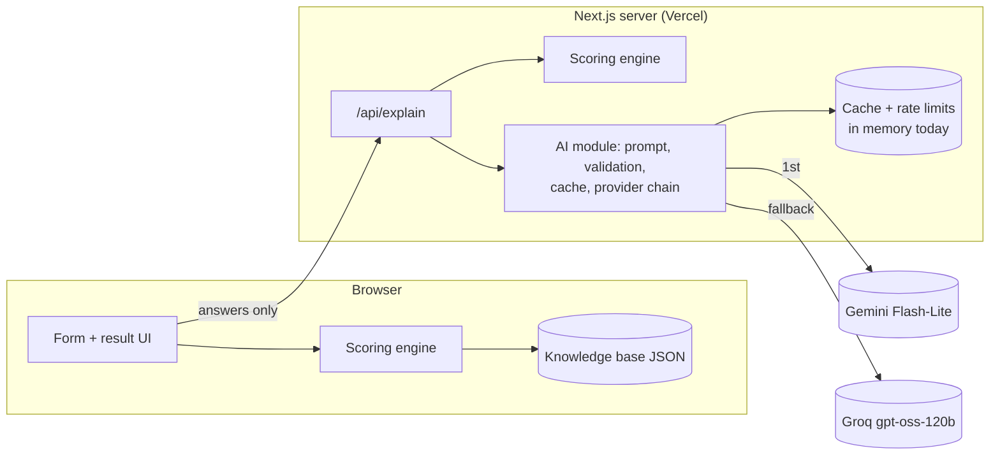

# Architecture Advisor

A free web app that helps students, developers and small teams choose a software architectural style.

Describe your system (the quality attributes you care about, business drivers, constraints, and anything else in plain words). You get:

- a **ranked list of architectural styles** with transparent scores,
- a **plain-language explanation** of the top pick and why the others ranked lower,
- a **trade-off table** built from a curated knowledge base (never AI-generated).

Share a result with **Copy link**: the answers travel in the link, so whoever opens it sees the same ranking.

## How it works

A **deterministic rule engine** scores 13 styles against your weighted priorities using a knowledge base drawn from established literature (e.g. Richards & Ford, _Fundamentals of Software Architecture_). An **AI layer** (free-tier Gemini Flash-Lite, falling back to Groq) can nudge scores by at most ±5 points, each with a stated reason, and writes the explanation. If the AI is unavailable, you still get the complete rule-based result.

## Status

v1 feature-complete, not yet deployed. Built: knowledge base, scoring engine, 4-step form, result (with a shareable link), methodology, about and privacy pages, and the AI explanation (Gemini → Groq → rules-only, both providers checked live). Deployment to Vercel is next. See [`docs/ROADMAP.md`](docs/ROADMAP.md).

## Architecture

The app is a **modular monolith** on Next.js ([ADR-001](docs/adr/001-modular-monolith-on-nextjs.md)). The same pure scoring engine runs in the browser (instant result) and on the server (trusted copy for the AI step).



What happens on submit:

```mermaid
sequenceDiagram
  participant B as Browser
  participant A as /api/explain
  participant L as Gemini → Groq
  B->>B: score(input) in the browser
  B-->>B: show ranking + trade-off table at once
  B->>A: POST { input }
  A->>A: validate, rate-limit, recompute the score
  A->>L: small prompt (cache miss only)
  L-->>A: JSON (checked; one repair retry)
  A-->>B: { ai: status, adjustments (±5), explanation }
  B-->>B: merge; banner if the AI changed the #1 pick
```

The AI can never break the result: on any failure the page keeps the complete rule-based ranking. Module boundaries (the engine can't import React, Next, the network or the AI) are checked by `npm run fitness`. More in [`docs/ARCHITECTURE.md`](docs/ARCHITECTURE.md).

### Decisions (ADRs)

| ADR                                                      | Decision                                                             |
| -------------------------------------------------------- | -------------------------------------------------------------------- |
| [001](docs/adr/001-modular-monolith-on-nextjs.md)        | Modular monolith on Next.js / Vercel                                 |
| [002](docs/adr/002-hybrid-rules-plus-bounded-ai.md)      | Hybrid rule engine + AI, AI bounded to ±5 points                     |
| [003](docs/adr/003-kb-as-versioned-json.md)              | Knowledge base as versioned JSON + Zod, no database in v1            |
| [004](docs/adr/004-engine-in-browser-and-server.md)      | One pure engine, run in the browser and on the server                |
| [005](docs/adr/005-ai-fallback-chain.md)                 | Gemini Flash-Lite → Groq → rules-only fallback chain                 |
| [006](docs/adr/006-upstash-for-cache-and-rate-limits.md) | Upstash Redis for cache and rate limits (in-memory until it's added) |
| [007](docs/adr/007-patterns-shown-not-ranked.md)         | Patterns are shown as companions, not ranked                         |

## Run it locally

Needs Node 22+.

```bash
npm install
npm run dev            # http://localhost:3000 (/advisor is the tool)
```

With no `.env.local` the app runs rules-only (`AI_MODE=off`), which is a complete result. To try the AI states without keys, run `AI_MODE=mock npm run dev`.

## Test and build

```bash
npm run check          # lint + typecheck + format + fitness + all Vitest tests with coverage
npm run build          # production build (also validates the knowledge base)
npm run bundle:check   # after build: client JS per page ≤ 200 KB gzipped
```

Those three are all you need before pushing (there is no CI server). Others:

```bash
npm test               # Vitest only: unit, property, golden-scenario, KB, form, AI (mocked) and API tests
npm run lint           # ESLint (incl. purity rules for the engine)
npm run typecheck      # next typegen + tsc
npm run fitness        # module-boundary and env-name checks
npm run golden:print   # print the top 5 styles for each golden scenario
npm run kb:release-gate  # fails if any KB source is unreviewed
npm run test:e2e       # optional: Playwright after `npm run build` (needs Chromium: `npx playwright install chromium` once)
```

The e2e suite starts four production servers: AI off, and `AI_MODE=mock` with `AI_MOCK=ok`, `fail` and `reorder`. No test ever calls a real AI provider.

### Environment

Copy `.env.example` to `.env.local` and fill in your keys (`.env.local` is git-ignored).

| Variable                                   | Default                    | Meaning                                                                        |
| ------------------------------------------ | -------------------------- | ------------------------------------------------------------------------------ |
| `AI_MODE`                                  | `off`                      | `off`: rules only · `mock`: fixture replies, no quota · `live`: real providers |
| `GEMINI_API_KEY`, `GEMINI_MODEL`           | –, `gemini-3.5-flash-lite` | Provider 1 (skipped when the key is empty)                                     |
| `GROQ_API_KEY`, `GROQ_MODEL`               | –, `openai/gpt-oss-120b`   | Provider 2 (skipped when the key is empty)                                     |
| `AI_MOCK`                                  | `ok`                       | With `mock`: `ok`, `reorder`, `invalid`, `slow`, `429`, `fail`                 |
| `CACHE_IDENTICAL_REUSE`, `AI_DAILY_BUDGET` | `true`, `1300`             | Cache and quota tuning ([AI_INTEGRATION §12](docs/AI_INTEGRATION.md))          |

Keys are server-only and must never start with `NEXT_PUBLIC_` (a fitness check fails the build if they do). Both providers are free tiers.

## Docs

| Doc                                                  | What's inside                                            |
| ---------------------------------------------------- | -------------------------------------------------------- |
| [Project overview](docs/PROJECT_OVERVIEW.md)         | Goals, users, non-goals                                  |
| [Research](docs/RESEARCH.md)                         | Sources, free LLM tiers, hosting limits                  |
| [Requirements](docs/REQUIREMENTS.md)                 | Functional and non-functional requirements               |
| [Knowledge base draft](docs/KNOWLEDGE_BASE_DRAFT.md) | Styles, scores, drivers, rules, sources, calibration log |
| [KB schema](docs/KNOWLEDGE_BASE_SCHEMA.md)           | JSON structure                                           |
| [Scoring engine](docs/SCORING_ENGINE.md)             | Formula and worked examples                              |
| [AI integration](docs/AI_INTEGRATION.md)             | Providers, prompts, validation, caching                  |
| [Architecture](docs/ARCHITECTURE.md)                 | The app's own architecture (C4, modules, ADRs)           |
| [UI/UX](docs/UI_UX.md)                               | Pages, form, result layout, states                       |
| [Tech stack](docs/TECH_STACK.md)                     | Next.js, TypeScript, Vercel, Upstash                     |
| [Testing](docs/TESTING_STRATEGY.md)                  | Unit, property, golden-scenario and AI tests             |
| [Open questions](docs/OPEN_QUESTIONS.md)             | Decisions log                                            |
| [ADRs](docs/adr/README.md)                           | Architecture decision records 001–007                    |
| [Handoff](docs/HANDOFF.md)                           | What's done and what's next                              |

## Stack

Next.js · TypeScript · Tailwind + shadcn/ui · Zod · Vercel AI SDK · Vitest · Playwright · Vercel (free tier) · Upstash Redis (planned, Q25)
