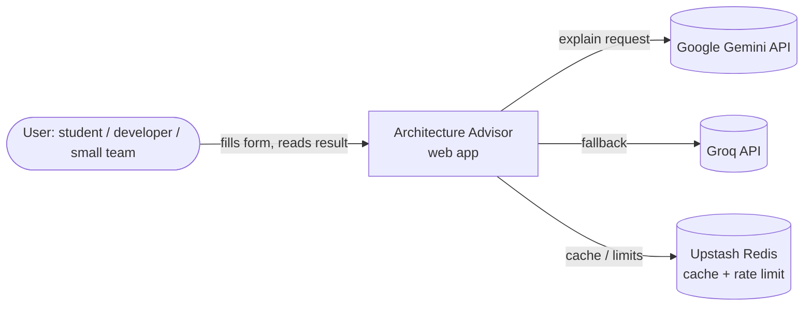
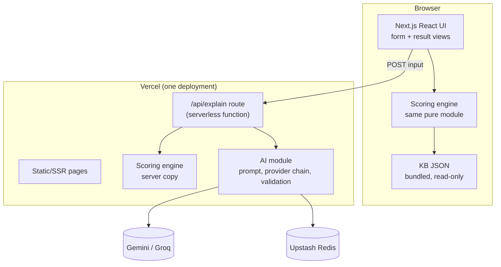
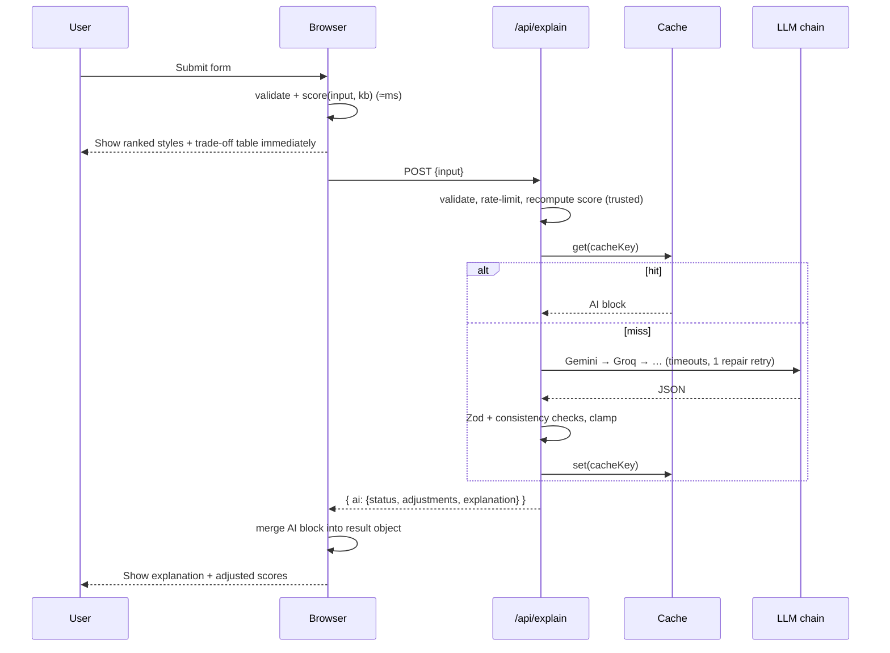

# Architecture of the App Itself

## 1. Our own drivers (eating our own cooking)
| Driver | Value |
|---|---|
| Team | 1 developer, learning |
| Budget | Zero (free tiers only) |
| Growth | Small, possibly spiky (shared in a class or on social media) |
| Lifespan | Several years (portfolio + real users) |
| Hosting | Vercel managed serverless |

| Quality attribute | Importance | Why |
|---|---|---|
| Testability | Critical | Wrong scores = wrong advice for everyone; the engine must be provably correct |
| Availability (graceful degradation) | Critical | Must always return a result even when AI providers are down |
| Low cost | Critical | Free tiers only |
| Simplicity | High | One developer |
| Maintainability / evolvability | High | KB and rules will be tuned for years; login comes later |
| Security | Medium | API keys, abuse of AI quota; no sensitive user data in v1 |
| Performance | Medium | Instant rule result; AI may take seconds |
| Scalability | Low | Static pages + light functions scale on Vercel anyway |

Run through our own engine, this profile picks a **modular monolith**. We confirm it by reasoning: one quality-attribute scope → one architectural quantum (Richards & Ford) → monolith is viable. Distribution would add cost and ops work with no benefit.

## 2. Chosen style: modular monolith on serverless hosting
- **One Next.js app, one deployment**, split internally into **domain modules** with strict boundaries.
- Vercel runs the API routes as serverless functions. That's a *hosting* detail, not an architectural split: there's still one codebase, one deploy, one quantum.
- Inside the AI module we use **ports and adapters** (an interface for "LLM provider" with one adapter per vendor) plus a **circuit-breaker-style fallback chain**.

Rejected alternatives:
| Option | Why not |
|---|---|
| Separate backend service (e.g. Express/FastAPI) + SPA | Two deploys, CORS, two hosts. More cost and complexity, no gain |
| Microservices (engine service, AI service…) | Textbook over-engineering for 1 dev (cf. the Prime Video case: distribution has real costs) |
| Rules engine only in browser, AI called directly from browser | Would expose API keys. Not allowed |
| Event-driven queue for AI calls | AI calls are short and synchronous; a queue adds infrastructure for nothing |

## 3. C4 Level 1: System context


## 4. C4 Level 2: Containers


## 5. Request flow

Key property: **the AI call can't block or break the core result.**

## 6. Modules and dependency rules
```
src/
  app/                         # Next.js routes (thin)
    page.tsx                   # landing
    advisor/page.tsx           # form + result (client component)
    methodology/page.tsx       # how scoring works (static, from KB)
    styles/[id]/page.tsx       # style catalog (v1.1)
    api/explain/route.ts       # POST: AI explanation
  modules/
    knowledge-base/            # data/*.json, schema.ts (Zod), index.ts (typed loader)
    scoring/                   # PURE: engine.ts, weights.ts, rules.ts, types.ts
    recommendation/            # builds the Result object; merges AI block; result schema
    ai/                        # prompt.ts, schema.ts, chain.ts, validate.ts, providers/{gemini,groq,...}.ts
    platform/                  # cache.ts, rate-limit.ts, env.ts (server-only)
  components/
    form/  result/  ui/        # React components (shadcn/ui based)
  lib/                         # tiny generic helpers
tests/
  scoring/ kb/ ai/ e2e/
docs/
  adr/                         # Architecture Decision Records
```

**Allowed dependencies** (enforced by a fitness function, below):
```
app → components → recommendation → scoring → knowledge-base
app/api → recommendation, ai, platform
ai → scoring (types only), recommendation (types only: AiBlock), knowledge-base, platform
scoring → knowledge-base (types + data only)   ✗ no next/*, react, fetch, ai, platform
knowledge-base → (nothing)
```

**As built (session 2):** `app/` has `page.tsx` (landing), `advisor/`, `methodology/`, `about/` and `api/explain/route.ts`; `/styles` is v1.1. `components/` has `ui/` (hand-written shadcn-style), `form/` (steps, presets, form state), `result/` and `advisor/` (the page's client controller). `recommendation/` holds `buildResult`, `withAi`, `finalScores` and the `AdvisorResult`/`AiBlock` types. `platform/env.ts` reads `AI_MODE` and imports `server-only`. The KB is validated at build time in `next.config.ts` instead of at import, so the browser never loads Zod.

## 7. The Result object (single, self-contained JSON)
Designed so it can be saved to a DB later without changes.
```ts
interface AdvisorResult {
  id: string;                  // uuid (client-generated)
  createdAt: string;           // ISO
  versions: { app: string; kb: string; engine: string; prompt?: string };
  input: UserInput;            // exactly what the user entered
  rules: RuleResult;           // full engine output (see SCORING_ENGINE.md)
  ai: {
    status: "ok" | "cached" | "adapted" | "unavailable" | "rate_limited" | "skipped" | "disabled";
    reuse?: { tier: "identical" | "similar"; fits?: boolean; changes?: string[] };
    provider?: string; model?: string; latencyMs?: number;
    adjustments: { styleId: string; delta: number; reason: string; basis: string }[];
    explanation?: { summary: string; topPick: {...}; others: [...]; cautions: string[]; notesUsed: string[] };
  };
  final: { styleId: string; ruleScore: number; aiDelta: number; finalScore: number; rank: number }[];
  mentions: Mention[];          // glossary matches for the notes (KB, not AI)
  snapshot: { styles: Record<StyleId, { name: string; scores: Record<AttributeId, number>; estimated: AttributeId[] }> };
}
// "disabled" = AI_MODE=off on the server; "skipped" = the user opted out. id/createdAt come from the caller,
// so buildResult(input, kb, { id, createdAt, appVersion }, ai) stays pure.
```
`snapshot` stores the KB scores used, so a saved result still renders correctly after the KB changes. The trade-off table is rendered from `snapshot` (KB data), never from AI text.

## 8. Fitness functions (Ford et al., *Building Evolutionary Architectures*), run with `npm run check`
| Check | Tool |
|---|---|
| `scoring/` imports nothing outside `knowledge-base/` (no network, no React, no Next) | `dependency-cruiser` rule |
| No server-only module (`platform/`, `ai/providers`) imported by client code | `server-only` package + dependency-cruiser |
| KB valid; every style has every attribute; no unreviewed sources in production build | Vitest KB tests |
| Golden scenarios still produce expected top picks | Vitest |
| No `NEXT_PUBLIC_` env var containing `KEY` | `scripts/check-env-names.mjs` |
| Client JS bundle under budget (200 KB gz per page) | `scripts/check-bundle.mjs` (`npm run bundle:check`, after `next build`): sums the gzipped scripts each prerendered page loads, minus legacy polyfills. Session 2: `/` 135 KB, `/advisor` 187 KB |

## 9. ADRs to write at the start of build (Nygard / MADR format)
1. ADR-001 Modular monolith on Next.js/Vercel
2. ADR-002 Hybrid rules + AI; AI bounded to ±5 points
3. ADR-003 KB as versioned JSON + Zod, no database in v1
4. ADR-004 Rule engine runs in browser and server (same pure module)
5. ADR-005 Gemini Flash-Lite → Groq → rules-only fallback chain
6. ADR-006 Upstash Redis for cache and rate limiting
7. ADR-007 Patterns shown, not ranked
